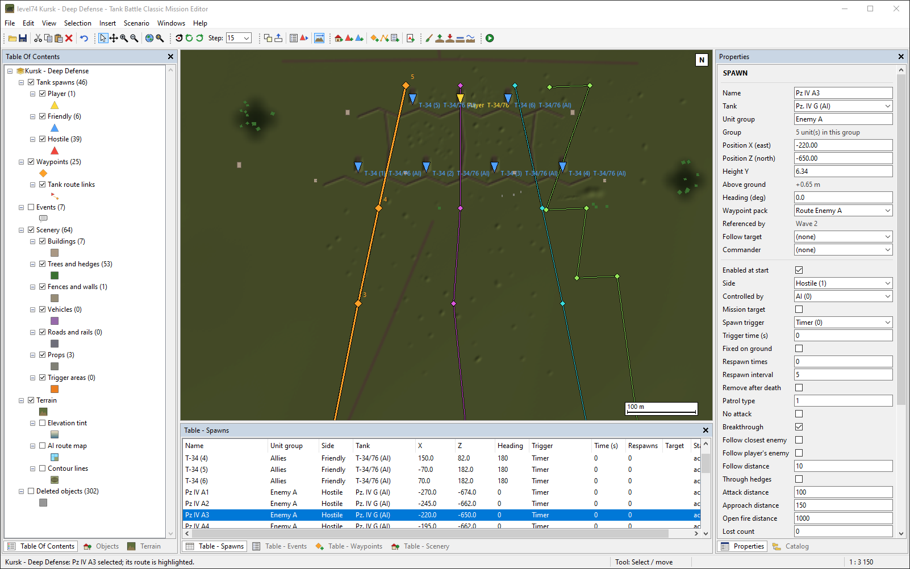
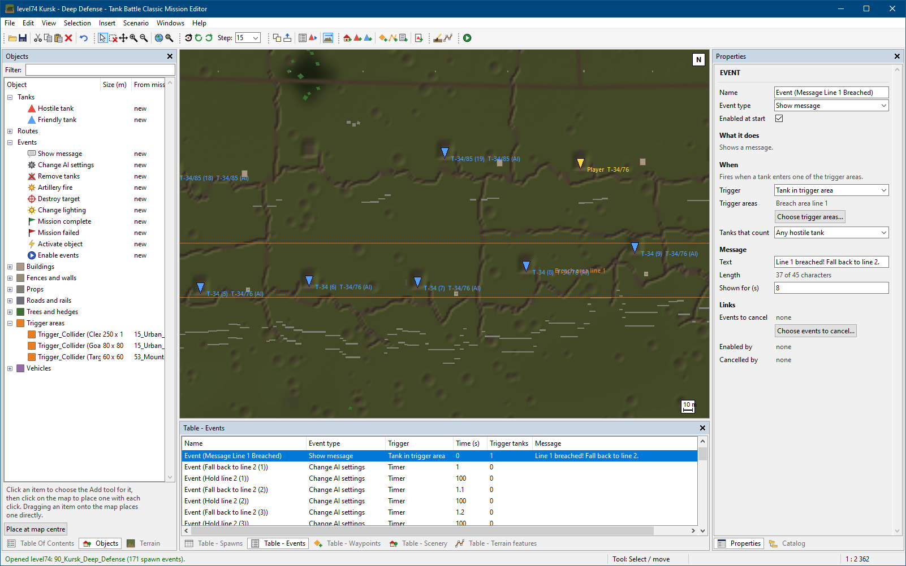
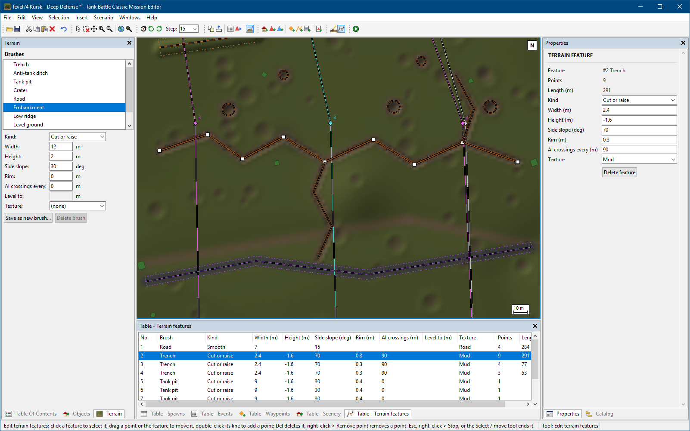

# Tank Battle Classic Mission Editor

Mission and map editor for the Windows game *Tank Battle Classic* (Steam). Edits your 
own installed copy. This unofficial application does not contain any game content and 
is not affiliated with the game's developer or publisher. Buy the game from 
https://store.steampowered.com/app/5086560/Tank_Battle_Classic/

## Start

Unzip the release into a folder of your own and run `TankBattleMissionEditor.exe`
(or `python editor.py` from source, see Build). The editor finds the game in your
Steam libraries or asks for its folder (File > Select game folder). Double-click
a mission in the Catalog. **Close the game before saving**; restart it to see
changes.

## What it does

- Edit tanks, waypoints, routes and scenery of any mission.
- Tank and mission settings: type, side, AI behaviour, respawns, fog.
- Events with timers, destroyed tanks or trigger areas, for example waves.
- New scenarios from a mission or on an empty terrain.
- Terrain painting and height brushes for custom scenarios.
- AI tanks of custom scenarios drive around changed terrain and objects.
- Back up, export and import scenarios.

## Tools and controls

One map tool is active at a time. It stays active until you choose another
tool. Its toolbar button stays pressed, and the status bar shows
its instructions. Esc, right-click > Stop, or a second click on the pressed
button returns to Select / move.

| Input | Action |
| --- | --- |
| Click / Shift+click / Ctrl+click | select / add / toggle |
| Drag on empty map / drag selection (Select / move) | selection box / move |
| Right-click | context menu; finishes a route being drawn |
| Wheel / middle or right drag, or Space held | zoom / pan (in any tool) |
| Backspace / Esc while drawing a route | remove the last waypoint / cancel the route |
| Ctrl+X / C / V | cut / copy / paste (at the pointer) |
| Del, Ctrl+D, Q / E | delete, duplicate, rotate |
| Ctrl+Z, Ctrl+S, Ctrl+A | undo, save, select all |
| Esc | cancel a route or selection box in progress, else back to Select / move, else clear the selection |

Help > Controls lists all shortcuts.

## Backups

The first save of a level keeps the original (File > Restore original).
Scenario > Remove custom scenarios undoes all scenarios. Steam's "Verify
integrity of game files" also restores everything.

Backups and settings are kept next to the program, in `backups\` and
`settings.json` (Help > Open backup folder). To update, unzip the new version
over the old `TankBattleMissionEditor` folder; the backups stay. If the program
folder cannot be written (for example under Program Files), the editor uses
`%LOCALAPPDATA%\TankBattleMissionEditor` instead. Data of earlier versions in
that folder is moved next to the program once.

Custom scenarios are backed up on every save. A game update removes them from
the game; the editor then offers to restore them, converted to the new game
version (also: Scenario > Restore scenarios from backup).

Scenario > Export scenario saves a scenario as one `.tbscenario` file to share;
Scenario > Import scenario installs one. The file holds no game files, only the
map and the names of the game assets it uses: the recipient needs the game and
this editor, in any game version.

## Limitations

- Only the game's existing objects and tank types.
- Every map uses one of the game's terrains. A custom scenario can repaint and
  reshape it, but cannot change its size.
- Terrain editing and the AI route map rebuild work on custom scenarios only.
- Saving a custom scenario rebuilds its AI route map when terrain or objects
  changed. The rebuilt map is close to the game's own; in dense city and
  mountain areas AI routes can differ.
- After a game update, objects whose scripts changed cannot be edited until a
  new version of the editor is released.

## Build

Requires Python 3.11+ on Windows.

    pip install -r requirements.txt
    python editor.py                      # run from source
    python -m unittest discover tests     # tests (need the installed game)
    python packaging/build_exe.py         # standalone executable + release zip

## Licence

Copyright (C) 2026 fierman. GNU General Public License version 3, see
`LICENSE`. Bundled third-party components: see the release's
`THIRD-PARTY-NOTICES.txt`.
